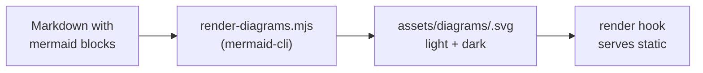

+++
title = "Diagrams"
description = "Render Mermaid diagrams at build time as static SVG — no JavaScript."
docType = "reference"
topics = ["diagrams", "mermaid", "render-hooks"]
tags = ["diagrams", "mermaid", "render-hooks"]
weight = 16
+++

Mermaid fenced blocks are rendered to SVG **at build time** by the diagram pipeline, so published pages contain plain images and stay JavaScript-free.



The pipeline hashes each block's source, writes the SVG under `assets/diagrams/`, and caches by hash — unchanged diagrams are never re-rendered.

## Running the pipeline

```bash
npm run diagrams   # rendered by build, check, and test automatically
```

A block whose diagram has not been rendered yet falls back to a plain code block, so builds never break while you draft. Set `params.docs.mermaid.enforce = true` to turn the fallback into a build warning (which fails `--panicOnWarning` CI builds).

## Captions and alt text

```mermaid {title="Diagram pipeline" alt="Flowchart of the diagram pipeline"}
flowchart TD
    a["Source"] --> b["SVG"]
```

Fenced-code attributes set the `title` (figcaption) and `alt` text; the title is also used as alt text when `alt` is absent.

## Dark mode

The pipeline writes one SVG per theme (`<hash>.svg` for light, `<hash>.dark.svg` for dark). The render hook emits both images and CSS swaps them with the theme switcher and the OS preference — no JavaScript involved.


Diagrams are static images: they do not re-layout at runtime and require the pipeline (mermaid-cli) to run before publishing. The theme ships no client-side Mermaid library, keeping its zero-runtime-request contract intact.

